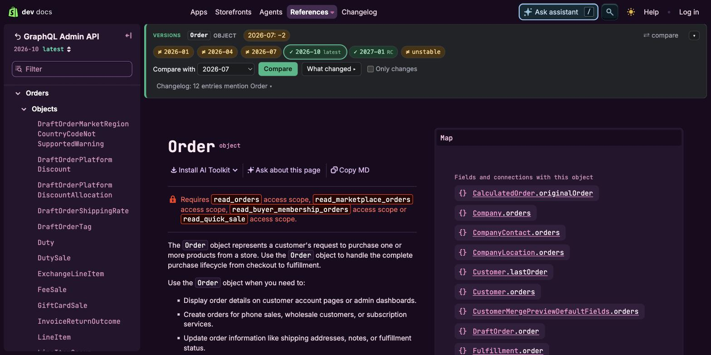
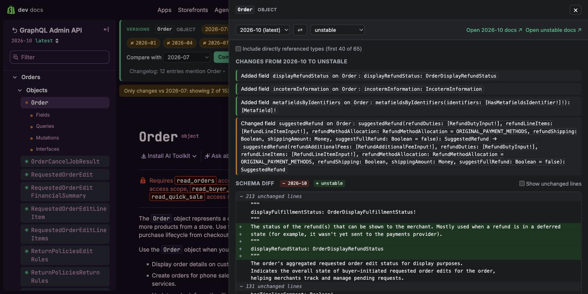
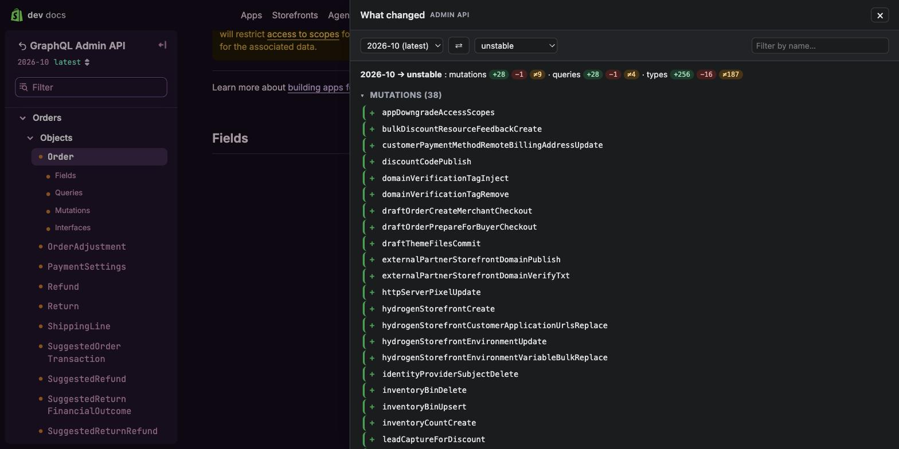
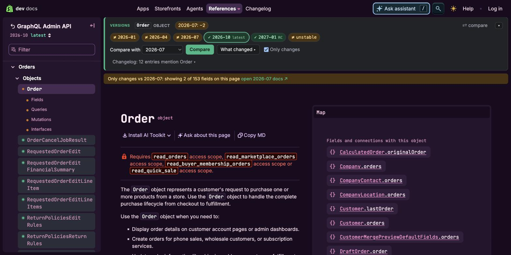
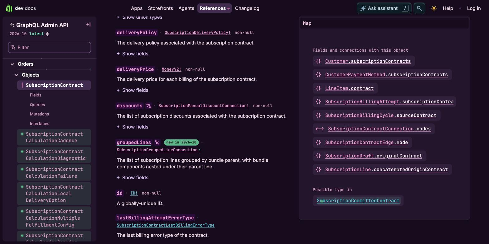
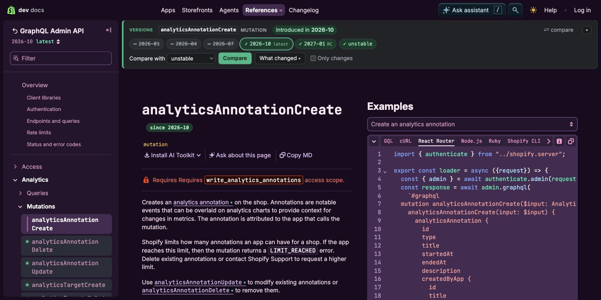

# Shopify Dev Version Compare

A Chrome extension for the GraphQL reference pages on [shopify.dev](https://shopify.dev)
(Admin API and Storefront API). On a mutation, query, object, interface, union, enum,
input object, scalar, connection or payload page it shows, at a glance, how the item has
changed across API versions and lets you diff it against any other version, including
`unstable`.

## Screenshots

**Version banner** on every reference page: lifecycle facts, one chip per version (✓ identical,
≠ different, – missing), compare target, global report and the "only changes" filter.



**Compare panel**: plain-language summary of what changed plus a schema diff. Type pages can pull
in directly referenced types.



**What changed between two versions**: every added, removed or changed mutation, query and type,
grouped and linked, with inline details.



**Only changes**: the sidebar and the field list collapse to what differs in the compare target.



**Field badges**: when each field appeared, deprecations, and differences against the target.



**New in this version**: sidebar dots and the title badge for what the viewed version introduced.



## What you get

**Banner** at the top of the page

- **Introduced in** / **Removed in** / **Deprecated since**. Items that exist in every queryable
  version get no lifecycle chip; "Available since X or earlier" only appears when an older version
  could not be checked.
- A chip per browsable version: ✓ identical to the version you are viewing, ≠ different,
  – missing. Click a chip to open the diff.
- A summary of what the compare target changes, for example `unstable: +3 fields ≠1`.
- Matching **developer changelog** entries, with their version and "breaking" tags.
- Collapse toggle (remembered), a quick "⇄ compare" button and a compare target dropdown. The
  target you pick is remembered per API, so new pages and tabs keep comparing against it; the
  popup's "default compare target" is only the fallback.

**Inline badges** in the docs themselves

- A `since 2026-07` badge next to the page title (omitted for items present in every version).
- Badges next to each field, argument, input field or enum value: `since <version>`,
  `deprecated since <version>`, `removed in <version>`, `not in <target>`, and `≠ <target>`
  when the signature differs in the compare target (click it to open the diff).

**New in this version** (what the version you are viewing introduced, compared with the
previous one)

- Sidebar entries for mutations, queries and types that are new get a green dot and a faint
  tint; links in the page body get a small green "•".
- Fields, arguments, input fields and enum values that are new get a `new in <version>`
  badge and a green underline on their name.
- Needs a previous version to compare against, so nothing is marked on the oldest
  browsable version.

**What changed between two versions** (the whole API at once)

- "What changed ▸" in the banner, the popup button, or `Alt+Shift+G` opens a report listing every
  mutation, query and type that was added, removed or changed between two versions, grouped by
  docs category, with a name filter and links to the docs. "details" on a changed entry shows the
  field-level changes inline.
- "Only changes" in the banner hides sidebar entries, fields, arguments and enum values that are
  identical in the compare target, so a long page or sidebar collapses to what actually differs.
  Changed entries get an amber dot, entries missing from the target a red (removed) or green
  (newer) dot. A note above the page lists members that exist only in the target.
- Both are powered by a per-version schema fingerprint: one description-free introspection
  (about 3.5 MB) reduced to a structural hash per type and root field (about 250 KB), cached like
  everything else and prefetched in the background. Description-only edits do not count as changes
  here; the per-item compare panel still shows them.

**Compare panel**

- Plain-language summary: added/removed/changed fields, arguments, enum values, input
  fields, interfaces, possible types, deprecations and description updates.
- Line-by-line GraphQL SDL diff (Myers algorithm, linear space) with context folding.
- Mutations and queries include their payload and input types automatically. For type pages,
  tick "Include directly referenced types" to diff one level deeper (capped at 40 types).
- Links to the docs of both versions, swap button, Esc to close.

**Keyboard shortcuts**: `Alt+Shift+U` compares the current item with `unstable`, `Alt+Shift+G`
opens the global report (change them at `chrome://extensions/shortcuts`).

**Popup settings**: collapse by default, toggle inline badges, member badges, changelog, new-in-version marks,
background prefetch, default compare target, cache size and a clear-cache button.

## Install (unpacked)

1. Open `chrome://extensions`, enable **Developer mode**.
2. **Load unpacked** and select this folder. After pulling updates, click the extension's
   **reload** button on that page.
3. Open a reference page, for example
   https://shopify.dev/docs/api/admin-graphql/unstable/mutations/subscriptionContractFail

## How it works

- `content/content.js` detects reference pages from the URL, reads the versions from the
  page's own version selector, renders the banner, badges and compare panel, and polls the
  URL so the docs' client-side navigation is handled. It waits briefly after page load so
  React can hydrate before the DOM is touched.
- `background.js` talks to `https://shopify.dev/<api>-graphql-direct-proxy/{version}`, the
  public, unauthenticated GraphQL proxy the docs' GraphiQL explorer uses. Loading happens in
  two phases: a small per-version name index answers "does it exist?" immediately, then full
  definitions load for the diff and badges. Named types are fetched in batched queries. Root
  field maps for all versions are prefetched in the background so later pages are instant.
  Everything is cached in `chrome.storage.local` (24 h for stable versions, 1 h for
  `unstable`, 6 h for the changelog feed), with in-flight de-duplication.
- The changelog comes from `https://shopify.dev/changelog/feed.xml`. An entry matches when
  the item name appears in the title or in a `<code>` tag, or anywhere in the text for
  long camelCase names, and the entry's API category matches the page's API.
- `content/sdl.js` prints introspection JSON as SDL and extracts "members" (fields,
  arguments, enum values…); `content/diff.js` holds the Myers diff and the change summary.

## Limitations

- shopify.dev and its proxies only expose currently supported API versions. If an item
  already exists in the oldest one, the banner says "available since 2026-01 or earlier".
- Only the Admin and Storefront APIs have a public proxy; Customer Account, Partner and
  Payments Apps reference pages are not covered.
- Union pages get no per-member badges because the docs do not render anchors for possible
  types.
- The banner is inserted at the top of the docs' `main` element and badges are attached to
  the docs' own `id` anchors (`arguments-x`, `fields-x`, `enums-x`,
  `field-Type.fields.x`). If Shopify changes the markup, update `mountBanner()` and
  `memberAnchor()` in `content/content.js`.

## Development

```
python3 icons/gen.py          # regenerate icons
node --check background.js    # syntax checks
```

## License

MIT, see `LICENSE`. Not affiliated with Shopify; it only reads the public schema proxy and
changelog feed that shopify.dev serves to every visitor.
